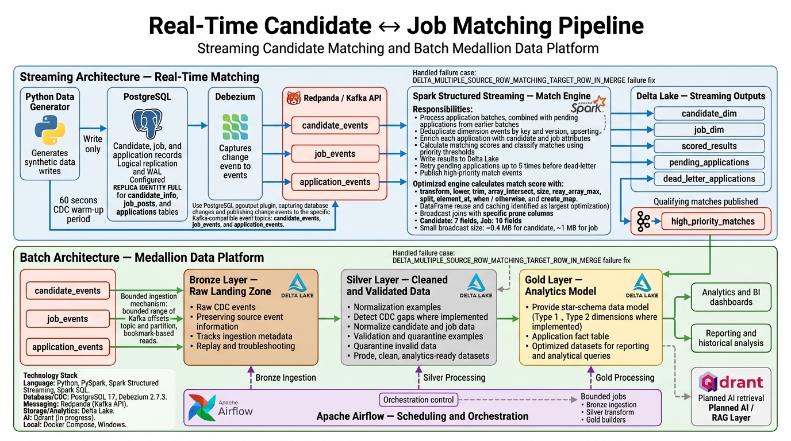

# Real-Time Candidate–Job Matching Pipeline

An end-to-end recruitment data platform that simulates candidate, job, and application activity in PostgreSQL, captures database changes through Debezium on the **Apache Kafka 3.8.0 (KRaft)** broker, and processes those changes through **multiple independent data paths**:

- **Streaming matching path:** scores applications in near real time with Spark Structured Streaming and writes match results to Delta Lake. High-priority matches are also published to Kafka.
- **Batch medallion path:** lands raw CDC events in Bronze, cleans and validates them in Silver, and builds a dimensional analytics model in Gold.
- **Kafka integration path (2026 addition):** a production-style Kafka layer for duplicate rejection, job-state invalidation, windowed recruiter statistics, spam alerts, and JDBC sinks into a separate analytics PostgreSQL - built without any Java code of our own (Quix Streams + ksqlDB).

The project demonstrates CDC, stream processing, data quality, Delta Lake upserts, dimensional modeling, and pipeline observability. It was developed and run on Windows.

> **Project status:** The streaming pipeline and batch medallion components are the core of the project. A Qdrant-based recruitment intelligence/RAG layer is in progress; see [Roadmap](#roadmap).

## What's new — Kafka integration layer (2026)

A second, business-facing Kafka layer now runs alongside the Spark match engine:

| Layer | Tech | Deliverable |
|---|---|---|
| Web-event ingestion & dedup | Quix Streams (python), exactly-once, `docker` service `stream-processor` | `application_submitted_events` -> stateful `application_submitted_dedup` (Avro + Schema Registry) with every reject going to a DLQ |
| Job state / invalidation | ksqlDB 7.6.1 (`ksql/01..04.sql`) | `job_state` KTABLE, closed/filled/deleted invalidation stream + stream-table JOIN prevention leg -> `match_invalidation_events` |
| Live recruiter statistics | ksqlDB windowed CTAS | 5-min tumbling + 10-min hopping windows -> `job_metrics_5m` (Avro) |
| Spam/anomaly detection | ksqlDB CTAS | candidates exceeding application-rate threshold -> `application_alerts` |
| Analytics serving | Debezium JDBC Sink Connector (built image `docker/kafka-connect-extended.Dockerfile`) | upserts into PostgreSQL **analytics** DB (`job_metrics_5m`, `application_alerts`, `job_current_state`) |
| Fault injection & proof | synthetic producer + 6 acceptance suites (`tests/`) | duplicates, malformed payloads, closed-job flows, window math, sink replay idempotency, latency SLA |

### Documented trade-offs you will be asked about

1. **ksqlDB group-by keys are not in windowed-table values.** The JDBC sink would have no `job_id` column, so the aggregating queries re-project the key into the value via `LATEST_BY_OFFSET(job_id) AS JOB_ID_FLAT` (documented in `ksql/03_windowed_metrics.sql`). The alias must differ from the key column name; otherwise ksql rejects the duplicate value column.
2. **ksql windowed keys are a proprietary binary blob**, not JSON — the JDBC sinks therefore use `key.converter=org.apache.kafka.connect.storage.StringConverter`, and the value fields are renamed by a `ReplaceField$Value` SMT (`JOB_ID_FLAT -> job_id`, `WINDOW_START/WINDOW_END -> window_start/window_end`; `RenameField` does not exist in Kafka 3.7 transforms). `quote.identifiers=false` (the live config key - **not** `quote.sql.identifiers`) keeps Postgres from case-folding.
3. **Window columns are BIGINT epoch-millis**, not TIMESTAMP: ksqlDB exposes `WINDOWSTART`/`WINDOWEND` as BIGINT and Debezium maps Avro `long` -> Postgres `BIGINT`. `database/init_analytics.sql` declares them BIGINT for exactly this reason.
4. **`__debezium-heartbeat.talent`** is Debezium's heartbeat topic; it is pre-created in `scripts/create_topics.ps1` so monitors never see a transient missing-topic state.
5. **`enable.thread.pin` was removed** from the producer config: it existed in older librdkafka builds and confluent-kafka 2.9 rejects it as an unknown property.
6. **CDC topics stay JSON; the dedup boundary is Avro.** `application_submitted_events` and its outputs are Confluent-wire Avro with Schema Registry back-compat (BACKWARD); raw CDC and `match_invalidation_events` stay JSON on purpose (Spark consumes natively; `schemas/match_invalidation.avsc` is the registered schema of record for that contract, including the note that ksqlDB uppercases unquoted identifiers on the wire).
7. **`tombstones.on.delete=false`** on the source connector: delete events keep a full `before` payload so ksql/Quix can still parse them; the COMPACTED state topics carry table semantics instead of relying on tombstone compaction of the CDC topics.

### Acceptance tests (all runnable, results are recorded, never invented)

```
powershell -ExecutionPolicy Bypass -File tests\run_all.ps1
```

| Suite | Proves |
|---|---|
| `01_pipeline_health` | containers, topics, connectors, ksql persistent queries, analytics schema |
| `02_dedup_dlq_integrity` | per-`event_id` accounting: e.g. real run 116 in = 60 unique + 44 DUPLICATE-DLQ + 12 BAD_WIRE_HEADER-DLQ, zero unaccounted |
| `03_job_state_invalidation` | SQL close -> Debezium -> ksql legs -> topic record -> Spark Delta `match_invalidations` row |
| `04_windowed_metrics` | `job_metrics_5m` rows with only 300000/600000 ms window widths, no duplicate PKs |
| `05_jdbc_sink_upsert` | replaying a real `job_metrics_5m` record changes neither PK count nor totals |
| `06_latency_freshness` | end-to-end producer->dedup p95 (measured 5996 ms; SLA 10000 ms) |

### Demo operations

```powershell
scripts\setup.ps1   # bootstrap: venvs + images + containers + topics + connectors + ksql (idempotent)
scripts\run.ps1     # containers + Spark match engine + optional generators (background, logged)
scripts\stop.ps1    # stop helpers + docker compose stop (volumes kept)
scripts\reset.ps1   # full teardown -v (THIS project only) + rebuild
```

Monitoring: `monitoring\lag_report.ps1` (consumer lag + threshold exit code), `monitoring\latency_report.py` (p50/p95 vs 10 s SLA), `monitoring\load_test.ps1` (drives the real producer with fault knobs).

Details: `docs\architecture.md`, `docs\topics_and_keys.md`, `docs\troubleshooting.md` (real gotchas that bit this build), `docs\interview_map.md` (question -> code -> measured number).

## Table of contents

- [What's new — Kafka integration layer (2026)](#whats-new--kafka-integration-layer-2026)
- [Architecture](#architecture)
- [Technology stack](#technology-stack)
- [Main components](#main-components)
- [Streaming matching path](#streaming-matching-path)
- [Batch medallion path](#batch-medallion-path)
- [Data model](#data-model)
- [Performance Improvements — Streaming Match Engine](#performance-improvements--streaming-match-engine)
- [Measured results](#measured-results)
- [Setup and configuration](#setup-and-configuration)
- [Running the project](#running-the-project)
- [Known limitations](#known-limitations)
- [Roadmap](#roadmap)

## Architecture

The Python generator writes to PostgreSQL only. Debezium captures committed database changes from PostgreSQL's write-ahead log (WAL) and publishes them to Apache Kafka topics. The streaming and batch paths then consume those topics independently.

<p align="center">
  
</p>
### Event topics

| Topic | Source entity / producer |
|---|---|
| `candidate_events` | `public.candidate_info` (Debezium CDC) |
| `job_events` | `public.job_posts` (Debezium CDC) |
| `application_events` | `public.applications` (Debezium CDC) |
| `application_submitted_events` | Kafka-native Avro producer (synthetic web events; dedup input) |
| `application_submitted_dedup` | Quix Streams stateful dedup output (exactly-once) |
| `job_state_events` / `application_state_events` | Quix CDC projections (compacted tables for ksql) |
| `match_invalidation_events` | ksqlDB invalidation legs (closed/filled/deleted jobs) |
| `job_metrics_5m` | ksqlDB windowed aggregates (5m tumbling + 10m hopping) |
| `application_alerts` | ksqlDB spam/anomaly detection |
| `dlq.*` | dead-letter queues for duplicates, malformed payloads, projection and sink errors |
| `high_priority_matches` | Published by the streaming engine for high-priority matches |

The Debezium connector uses the PostgreSQL `pgoutput` plugin and routes source-table changes to the three event topics. The generator does **not** publish directly to Kafka.

## Technology stack

- **Language and processing:** Python, PySpark, Apache Spark Structured Streaming, Spark SQL
- **Kafka-native streaming:** Quix Streams 3.14 (python), ksqlDB 7.6.1 (SQL without Java)
- **Database and CDC:** PostgreSQL 17, Debezium 2.7.3 (+ Debezium JdbcSinkConnector 2.7.3, Kafka Connect 3.7)
- **Messaging:** Apache Kafka 3.8.0 (KRaft), Redpanda Console (UI), Schema Registry (Confluent 7.6.1)
- **Storage and analytics:** Delta Lake, analytics PostgreSQL (JDBC sink target)
- **Vector search / AI extension:** Qdrant (RAG layer in progress)
- **Local environment:** Docker Compose, Windows

## Main components

| Component | Responsibility |
|---|---|
| `docker-compose.yml` | Runs PostgreSQL, Apache Kafka (KRaft), Redpanda Console, Kafka Connect/Debezium, and Qdrant on `spark-network`. |
| `recruitment_lifecycle_generator.py` | Generates synthetic candidate, job, and application records with lifecycle-aware values and weighted operations. |
| `debezuim_connector.py` | Registers, checks, or deletes the Debezium connector through the Kafka Connect REST API. |
| `match_engine.py` | Runs the Spark Structured Streaming match engine and contains `process_application_batch()`, its `foreachBatch` handler. |
| `data_used.py` | Supplies reference lookup values such as titles, skills, certifications, salary ranges, and education levels. |
| `bronze/bronze_ingest.py` | Reads bounded Kafka offset ranges and appends raw CDC events to Bronze Delta tables. |
| `silver/silver_transform.py` | Flattens CDC events, deduplicates records, detects version gaps, normalizes values, and validates rows. |
| `silver/normalization.py` | Implements native Spark SQL normalization rules. |
| `silver/validation.py` | Defines entity-level data-quality rules and quarantine output. |
| `gold/scd2.py` | Reusable Slowly Changing Dimension Type 2 processor. |
| `gold/surrogate_keys.py` | Assigns stable sequential keys to Type 1 dimensions. |
| `gold/dim_candidate.py`, `gold/dim_job.py` | Build candidate and job SCD Type 2 dimensions. |
| `gold/dim_company.py`, `gold/dim_location.py`, `gold/dim_date.py` | Build company, location, and date dimensions. |
| `gold/fact_application.py` | Builds the application lifecycle fact table with historical dimension lookups. |
| `common/config.py`, `common/schemas.py` | Shared path/topic configuration and Debezium envelope schemas used by the batch code. These files were referenced in the project notes but were not included in the supplied component descriptions. |

## Streaming matching path

### Matching workflow

1. Spark consumes the candidate, job, and application CDC topics.
2. Candidate and job dimension changes are deduplicated by key and version, then upserted into Delta using `MERGE`.
3. New application events are combined with pending applications from earlier batches.
4. The engine enriches each application with candidate and job attributes, scores resolvable applications, and writes the results.
5. Applications whose candidate or job record is not available are retried. After the retry limit, they are written to a dead-letter table with a reason rather than being silently discarded.
6. Applications with a score of at least 80 are classified as high priority and published to `high_priority_matches`.

### Match score

The engine combines five components, each scored from 0 to 100:

| Component | Weight |
|---|---:|
| Skills overlap (Jaccard similarity) | 30% |
| Experience | 25% |
| Location | 20% |
| Salary | 15% |
| Language | 10% |

Separately, the generator's `compute_match_score()` helper applies a hard category gate when producing synthetic application behavior: cross-category pairs are capped at 0–20, while same-category pairs use skill (Jaccard) overlap. The streaming engine's application ranking uses the five-component weighted score shown above.

| Priority | Threshold |
|---|---:|
| `HIGH_PRIORITY` | Score ≥ 80 |
| `MEDIUM_PRIORITY` | Score ≥ 65 and below 80 |
| Low | Score below 65 |

An older version used 85 as the high-priority threshold; the current documented threshold is 80.

### Handling unresolved applications

- Applications are stored in `pending_applications` when candidate or job enrichment cannot be completed.
- The engine retries pending applications up to five times (`MAX_ENRICHMENT_RETRIES`).
- After the retry limit, records are moved to `dead_letter_applications` with a reason such as `candidate_not_found`, `job_not_found`, or both.
- A 60-second CDC warm-up period prevents newly created candidates and jobs from immediately being selected by the generator for new applications. This is longer than the configured 30-second Spark trigger and reduces temporary unresolved matches.

### Streaming performance optimizations

- Replaced Python UDF scoring with native Spark SQL expressions to avoid JVM-to-Python calls.
- Cached incoming, resolved, and scored DataFrames so repeated actions do not recompute the same lineage.
- Used broadcast joins for candidate and job dimensions, with column pruning before broadcast and cache.
- Used `isEmpty()` and Delta operation metrics where possible instead of extra `count()` actions.
- Deduplicated CDC rows before Delta `MERGE`, including delete events, to prevent multiple source rows matching the same target row.
- Added early exits for empty application batches and a shared cleanup path to unpersist cached frames.
- Pre-created Delta tables to avoid empty-DataFrame creation paths that triggered Python worker failures on some Windows setups.
- Configured Delta optimized writes and auto-compaction using the Delta properties supported by the project's Delta version.

### Streaming metrics

The engine records per-batch metrics in `batch_metrics.jsonl`, including batch duration, input throughput, incoming/resolved/unresolved/scored rows, high-priority rows, broadcast sizes, files read/written, shuffle volume, and selected stage timings.

## Batch medallion path

The batch pipeline is a set of bounded jobs intended to be triggered by Airflow, cron, or another scheduler. It shares the same Kafka CDC topics with the streaming path but is not the streaming match engine.

### Bronze — raw landing zone

- Reads a bounded range of Kafka offsets per topic and partition. On the first run it starts at `earliest`; later runs use the saved bookmark. The end offset is captured as `latest` at the start of each run.
- Stores a verbatim raw representation of each Debezium event. Bronze does not apply business normalization or validation; it is the replay source for downstream reprocessing.
- Writes append-only Delta data partitioned by `_ingest_date` and `op`, with schema evolution enabled.
- Includes event identity, Debezium fields, Kafka metadata, ingestion timestamps, and the original JSON string.
- Persists per-topic offset bookmarks as JSON files under `CONTROL_ROOT`.
- Caches Kafka and Bronze DataFrames to avoid repeated reads/parsing during emptiness checks, writes, offset aggregation, and row-count collection.

Important Bronze fields include `_event_id` (SHA-256 of topic, partition, and offset), `op`, `before`, `after`, `ts_ms`, `_kafka_key`, `_kafka_topic`, `_kafka_partition`, `_kafka_offset`, `_kafka_timestamp`, `_ingested_at`, `_ingest_date`, and `_raw_value`.

### Silver — clean CDC event history

Silver retains event history rather than collapsing each entity to only its latest state. Its grain is one row per entity ID, version, and operation.

Processing steps:

1. **Flatten the CDC envelope:** use `after` for create/update/read events and `before` for deletes; mark delete events with `is_deleted = true`.
2. **Drop rows without an entity ID.**
3. **Deduplicate:** use entity ID, version, and operation, retaining the latest source timestamp.
4. **Detect version gaps:** flag non-consecutive versions within an entity using `has_version_gap`. A gap is flagged rather than automatically dropped.
5. **Normalize** candidate and job attributes using native Spark SQL functions.
6. **Validate and quarantine:** invalid records are written to a per-entity quarantine Delta table with one record per failed rule.

`since_date` can limit processing to a specified ingestion date. Silver Delta output is append-mode and partitioned by operation.

#### Normalization examples

- **Skills and certifications:** lowercase and trim values, apply aliases, remove empty items, and preserve order. Examples include `js` → `javascript`, `pyspark` / `apache spark` → `spark`, and `powerbi` → `power bi`.
- **Country:** normalize aliases such as `US` / `USA` to `United States` and `UK` to `United Kingdom`.
- **Salary:** parse values such as `$120,000`, `120K`, and `120000` into integer-dollar values.
- **Experience:** parse ranges such as `2-4 years` or `2 to 4 years` into minimum and maximum years; `5+ years` becomes a minimum of 5 with a null maximum.

#### Validation and quarantine

Each row is evaluated against named rules. Failed rows are written to quarantine with `record_id`, entity, `validation_rule`, `rejection_reason`, and `processed_at`. Passing rows continue to Silver. Delete events are exempt from content checks.

| Entity | Example validation rules |
|---|---|
| Candidate | Candidate ID required; salary cannot be negative; GPA must be between 0 and 4. |
| Job | Post ID required; salary must be positive; deadline must be on or after post date; status and work mode must be recognized values. |
| Application | Application, candidate, and post IDs plus applied date required; status must be one of the defined lifecycle statuses. |

### Gold — analytical star schema

Gold builds a dimensional model from Silver's event history.

| Table | Type | Purpose |
|---|---|---|
| `dim_candidate` | SCD Type 2 | Candidate profile history, including normalized skills, experience, salary, and activity state. |
| `dim_job` | SCD Type 2 | Job history, including company, title, category, location, work mode, salary, skills, status, and lifecycle stage. |
| `dim_company` | Type 1 | Company lookup with a stable surrogate key and reference-data enrichment where available. |
| `dim_location` | Type 1 | City/country lookup with a stable surrogate key and available geography reference fields. |
| `dim_date` | Calendar dimension | Date attributes such as year, quarter, month, weekday, and weekend flag. |
| `fact_application` | Event/lifecycle fact | One row per application lifecycle event, supporting funnel and stage-duration analysis. |

#### SCD Type 2 behavior

The shared SCD2 processor:

- Chooses the highest-version event in the batch for each natural key.
- Computes a SHA-256 hash over tracked attributes to detect meaningful changes.
- Uses `valid_from`, `valid_to`, and `is_current` to track historical versions.
- Closes the previous current row when tracked data changes and adds a new current version.
- Treats unchanged tracked attributes as a no-op to avoid unnecessary history rows.
- Is designed as a reusable batch function that could later be called from a streaming `foreachBatch` job.

#### Stable surrogate keys and reference data

Company and location keys use sequential formats such as `COMP_000047` and `LOC_000125`. Existing entities retain their key across reruns; new keys are assigned deterministically to unkeyed entities.

The company dimension combines names from job posts and candidate work history. Firmographic fields are populated only when present in the starter file `reference/company_reference_seed.csv`; otherwise, values remain `Unknown` or null and `is_enriched` is false. Location attributes use `reference/country_reference.csv` and the starter city file `reference/city_geo_seed.csv`. These are sample reference datasets, not complete production-grade sources. `postal_code` is intentionally null because a postal code describes an address, not an entire city.

The date dimension is generated from 2023-01-01 through 2030-12-31. The application fact retains each lifecycle event and uses as-of joins so each fact links to the candidate and job dimension versions that were valid at that event timestamp.

### Batch design principles

- **Replayability:** Bronze retains raw CDC payloads for downstream reprocessing.
- **Traceability:** Kafka offset metadata and `_event_id` connect stored rows to source events.
- **Explicit data quality:** validation failures and CDC version gaps are visible rather than silently discarded.
- **Native Spark processing:** normalization and transformation use Spark SQL functions, avoiding Python UDFs and Python worker creation in the batch pipeline.
- **Honest enrichment:** starter reference datasets are identified as such; missing attributes use `Unknown`/null values rather than fabricated firmographic or geographic data.

## Data model

### PostgreSQL source tables

| Table | Entity | CDC notes |
|---|---|---|
| `candidate_info` | Candidate profiles | Includes created/updated timestamps and version; `REPLICA IDENTITY FULL` is required for the documented CDC setup. |
| `job_posts` | Job postings | Includes created/updated timestamps and version; `REPLICA IDENTITY FULL` is required for the documented CDC setup. |
| `applications` | Application lifecycle | Includes created/updated timestamps and version; `REPLICA IDENTITY FULL` is required for the documented CDC setup. |

### Synthetic lifecycle generation

The generator creates coherent, linked data rather than choosing every field independently:

- **Candidate:** category → seniority → title → experience → skills → salary → company history.
- **Job:** company → industry → category → title → seniority → experience → skills → salary → location.
- **Application:** applied → viewed → interview → offer → rejected or accepted.

The default workload is 1,000,000 operations. Entity and operation frequencies are weighted to produce a recruitment-like workload. Application inserts are category-aware for most attempts, with a random-pair portion to provide less relevant matches as well. Timing rules constrain application dates relative to posting and deadlines.

## Performance Improvements — Streaming Match Engine

This section focuses only on the streaming match engine in `match_engine.py`, including its `foreachBatch` handler, `process_application_batch()`. It does not describe the separate Bronze/Silver/Gold medallion jobs. The attached performance report and the saved project logs are the evidence base.

**Evidence policy:** implementation details below are documented changes. Runtime numbers are observations from specific runs with different input sizes, not a controlled before-and-after benchmark. No overall percentage speedup is claimed.

### 1. Replaced Python UDF scoring with native Spark SQL

**Change:** The optimized engine calculates the match score with built-in Spark SQL expressions such as `transform`, `lower`, `trim`, `array_intersect`, `size`, `regexp_extract_all`, `array_min`, `array_max`, `split`, `element_at`, `when` / `otherwise`, and `create_map`, rather than Python UDFs for the score components.

**Why it helps:** Python UDFs can send row data from the Spark JVM to Python workers and back, adding serialization and worker-boundary overhead. Native expressions stay in Spark's SQL execution path and can benefit from Catalyst optimization and code generation.

**Evidence status:** The optimized implementation and its historical notes document this change as the highest-impact optimization. The supplied runtime data does not isolate scoring time before and after the UDF replacement, so no separate speedup percentage is attributed to it.

### 2. Cached reused DataFrames to stop repeated lineage execution

**Change:** The engine caches intermediate DataFrames when the same computation feeds multiple actions:

- `incoming`: the union of new application events and pending retries.
- `resolved`: applications that have been enriched with their candidate and job records.
- `scored`: resolved applications after score calculation.
- Candidate and job dimension snapshots reused by joins and metrics.
- The high-priority subset only when it is known to be non-empty.

Cached frames are released through a shared `_finish()` cleanup path, including early-exit paths.

**Why it helps:** Spark DataFrames are lazy. An emptiness check followed by scoring, writing, or filtering can reevaluate the same joins and transformations unless the relevant result is cached. The resolved cache was explicitly identified in the source notes as the largest optimization found through log analysis. Caching `scored` also prevents the scoring lineage from being rerun for the output write and `HIGH_PRIORITY` check.

**Observed evidence:** The earlier engine incurred roughly **3 seconds** to check whether the `HIGH_PRIORITY` result was empty, even when no high-priority rows existed, because the score lineage could be recomputed. In a separate run after the warm-up fix, `high_priority_check_sec` declined from **2.925 s** in batch 0 to **0.074–0.075 s** in later batches. This later observation is consistent with a much cheaper check, but it is not a controlled before/after test of caching alone.

### 3. Broadcast-joined compact candidate and job dimensions

**Change:** The engine explicitly broadcasts candidate and job dimensions for application enrichment. It also selects only fields needed downstream before caching and broadcasting:

- **Candidate dimension:** 7 fields — candidate ID, name, skills, experience range, current salary, location, and nationality.
- **Job dimension:** 10 fields — post ID, company, job title, required skills, years of experience, salary, city, country, language, and work mode.

**Why it helps:** A broadcast join avoids shuffling the large application-side dataset to join small lookup dimensions, when those dimensions fit safely in memory. Column pruning reduces data read from Delta, cached in memory, serialized, and distributed to tasks.

**Measured evidence:** The 25 August logs show candidate broadcast sizes of approximately **0.40–0.44 MB** and job broadcast sizes of approximately **0.91–1.04 MB** in the batches summarized by the report. A separate run after the CDC warm-up fix reports broader approximate ranges of **0.0–0.44 MB** for candidates and **0.6–1.0 MB** for jobs. These are observations from different logged runs, not one universal range. The snapshots were small in the observed environment; the engine does not yet have a broadcast-size guard, and the values should be monitored as the data grows.

### 4. Reduced unnecessary Spark actions and added early exits

**Changes:**

- Uses DataFrame `isEmpty()` for emptiness checks rather than counting rows just to determine whether data exists.
- Avoids an extra unresolved-row `count()` where the Delta write's transaction metrics provide the needed metrics.
- Uses Delta operation metrics for row/file measurements where available rather than scanning the written data again.
- Exits early if there are no new or pending applications, avoiding dimension reads, joins, scoring, and writes for an empty cycle.
- Reuses cached dimension DataFrames for row-count metrics instead of triggering separate Delta scans.

**Why it helps:** Actions such as `count()` can force Spark to execute a lazy plan and scan data. Early exits and transaction-level metrics avoid work that does not contribute to match output.

**Evidence status:** These behaviors are documented in the optimized code. Individual time savings were not isolated in a controlled test.

### 5. Deduplicated CDC dimension events before Delta `MERGE`

**Change:** Before candidate and job dimension upserts, the engine deduplicates incoming CDC records by key and version using a window ordered by descending version, keeping the highest-version record per key. Delete events are included in this handling. The merge source is cached when reused.

**Why it helps:** Initial consumption from `startingOffsets=earliest` can deliver many changes for the same entity. Passing multiple source rows for one target key into Delta `MERGE` can create ambiguity or fail; deduplicating first makes the merge input unambiguous for the selected key/version rule and avoids processing superseded versions in the same batch.

**Reliability evidence:** The report documents a prior `DELTA_MULTIPLE_SOURCE_ROW_MATCHING_TARGET_ROW_IN_MERGE` failure on an initial backlog of approximately **38.7k application events, 13.8k candidate events, and 12.3k job events**. Pre-merge deduplication was the documented fix. The source does not quantify a throughput gain from the fix, so it is reported as a correctness and reliability improvement rather than a measured speedup.

### 6. Added explicit Debezium schemas

**Change:** The engine defines explicit `StructType` schemas for the Debezium envelope and the candidate, job, and application payloads, rather than inferring schemas at runtime.

**Why it helps:** Explicit schemas make parsing predictable for nested payloads, arrays, and nullable fields and avoid the overhead and uncertainty of schema inference. They also establish a stable parsing contract for the stream.

**Evidence status:** This is an implemented ingestion and correctness improvement. The logs do not provide a separate measurement of its impact on processing time.

### 7. Reduced table-initialization and Delta file overhead

**Changes:**

- Pre-creates `candidate_dim`, `job_dim`, `pending_applications`, and `dead_letter_applications` using `DeltaTable.createIfNotExists(...)`.
- Avoids constructing an empty DataFrame from a Python list/RDD just to initialize a schema, because that path can start Python workers on Windows.
- Enables Delta optimized writes and auto-compaction through the `properties.defaults.*` configuration form used by this project.

**Why it helps:** Direct table creation avoids needless Spark/Python initialization for empty tables. Optimized writes and compaction aim to reduce small-file overhead, but the benefit depends on the actual write pattern and must be verified through metrics such as `files_written`.

**Evidence status:** The table initialization change addresses a documented failure path. No controlled before/after file-count or write-time measurement was supplied for optimized writes or auto-compaction.

### 8. Hardened Windows worker behavior and resource cleanup

**Changes:**

- Pins `PYSPARK_PYTHON` and `PYSPARK_DRIVER_PYTHON` to the same `sys.executable`.
- Defaults to `local[2]` and enables `spark.python.worker.reuse=true` to limit simultaneous local process launches and reuse workers.
- Supports uncompressed Parquet output to bypass the native Snappy DLL path implicated in Windows worker failures.
- Centralizes `unpersist()` cleanup so cached frames are not retained across batches or early exits.
- Flushes stage logs promptly so the last completed step remains visible after a failure.

**Why it helps:** On the Windows development setup, worker startup, interpreter mismatches, native-library locks, and leaked caches were failure risks. Preventing crashes and cleanup leaks protects sustained processing, although these settings do not guarantee higher raw throughput. Uncompressed Parquet is a deliberate trade-off: it can avoid the Snappy failure path, but produces larger files and is not claimed as a storage-I/O speed improvement.

### 9. Improved unresolved-application handling and CDC warm-up

**Change:** The generator holds newly created candidates and jobs out of application selection for **60 seconds**, while the streaming trigger is **30 seconds**. The engine retries unresolved applications up to five times and then sends persistently unresolved records to `dead_letter_applications` with a reason (`candidate_not_found`, `job_not_found`, or both).

**Why it helps:** Debezium and Spark process source changes asynchronously, so a new application can reach the engine before its candidate or job is visible in the dimension table. The warm-up reduces this timing gap. Bounded retries preserve temporarily unresolved records without retrying permanently unresolved records forever.

**Measured observation:** In a separate run, `unresolved_rows` across batches 0–6 were **932, 949, 930, 923, 924, 43, and 30**. The count fell from **924 to 43** between batches 4 and 5, about a **95.3% reduction**. This is an observed change in that run, not proof that the warm-up alone caused the full reduction. The backlog also led to a one-time dead-letter flush after the retry limit.

### 10. Instrumented each batch to locate bottlenecks

**Change:** The engine writes metrics to `batch_metrics.jsonl`, including `batch_duration_sec`, `input_rows_per_sec`, incoming/resolved/unresolved/scored counts, `high_priority_rows`, candidate/job broadcast sizes, `files_read`, `files_written`, shuffle read/write volume, and timings for pending writes, resolved checks, scoring writes, and high-priority checks.

**Why it helps:** Stage timings help distinguish whether a batch is spending time in pending-state persistence, enrichment, scoring, or output. File and shuffle metrics help identify when storage layout or data movement becomes a bottleneck instead of relying on guesses based on total duration.

**Evidence status:** Metrics are present in the supplied logs and were used to identify pending-table persistence as the largest repeated stage cost. Instrumentation itself is not a speedup, but it makes future optimization and benchmarking more evidence-based.

### 11. Kept the streaming trigger aligned with observed workload

**Change:** The optimized engine uses a **30-second** trigger; an older version used **5 seconds**.

**Interpretation:** This is a stability and scheduling choice, not a performance improvement by itself. A shorter trigger is useful only when batch processing consistently completes within that interval. The saved run shows batches can take around or more than 30 seconds, particularly during initial replay, so trigger tuning should follow a controlled performance benchmark rather than be presented as a speedup.

### Observed streaming runtime

In the logged run on **25 August 2026**, batches 1–3 averaged about **500.6 incoming rows/second** and **31.3 seconds per batch**. Batch 0 took **85.163 seconds** during the larger initial replay. The repeatable cost exposed by stage metrics was pending-application persistence, at approximately **7.478–19.550 seconds** in batches 1–3.

The measured results section below contains the per-batch data and the stage timing table. Batch workloads differed, so these observations must not be presented as a controlled before/after benchmark or an overall percentage speedup.

### Remaining streaming-engine bottlenecks

- **Pending-state writes:** the largest repeated measured stage cost; optimize the pending Delta write path and validate changes using the same workload.
- **Repeated dimension snapshots:** candidate and job dimensions are re-read for each application batch. A stateful or controlled-refresh approach may lower repeated read cost, provided dimension freshness and correctness are preserved.
- **Broadcast growth:** add a size guard or an alternative join strategy if either dimension grows beyond a safe broadcast size.
- **Parquet size:** uncompressed output avoids the documented Windows Snappy failure path but creates larger files. Revisit compression only after the native-library issue is resolved and benchmarked.
- **Benchmark quality:** compare identical input workloads and offsets over at least three warm runs; report median duration and throughput separately for initial replay and steady-state processing.


## Measured results

The numbers in this section come from saved project logs and the attached performance report. They are actual observations, but the runs and batches had different workloads. They are **not** a controlled before-and-after benchmark, and they do not prove an overall percentage speedup.

### Streaming run — 25 August 2026

| Batch | Incoming rows | Scored rows | Duration | Input throughput | Relative to 30 s trigger |
|---:|---:|---:|---:|---:|---|
| 0 (initial replay) | 46,913 | 33,675 | 85.163 s | 550.86 rows/s | 55.163 s over |
| 1 | 17,518 | 5,037 | 38.999 s | 449.19 rows/s | 8.999 s over |
| 2 | 15,395 | 2,891 | 29.382 s | 523.96 rows/s | 0.618 s under |
| 3 | 13,488 | 985 | 25.517 s | 528.59 rows/s | 4.483 s under |
| **Batches 1–3 average** | **15,467** | **2,971** | **31.299 s** | **500.58 rows/s** | **1.299 s over on average** |

**Interpretation:** Batches 2 and 3 completed just under the 30-second trigger, while batches 0 and 1 exceeded it. Batches 1–3 ran at approximately **500.6 incoming rows/s** on average. Batch 1 to Batch 3 duration fell by **13.482 seconds (34.6%)**, and observed throughput rose from **449.19 to 528.59 rows/s (+17.7%)**. However, incoming volume also declined from 17,518 to 13,488 rows, so this trend is descriptive only, not a controlled speedup measurement. Batch 0 processed 46,913 incoming rows and included substantial initial candidate/job dimension upserts.

### Stage timings from the 25 August run

| Batch | Pending write | Resolved check | Scoring write | High-priority check |
|---:|---:|---:|---:|---:|
| 0 | 15.525 s | 8.236 s | 12.205 s | 1.224 s |
| 1 | 19.550 s | 1.446 s | 2.520 s | 2.581 s |
| 2 | 7.478 s | 3.060 s | 2.743 s | 0.246 s |
| 3 | 11.229 s | 2.054 s | 1.309 s | 0.110 s |

Pending-table writes were the largest repeated stage cost in batches 1–3, ranging from **7.478 to 19.550 seconds**. This makes pending-state persistence the clearest next optimization target supported by the logs.

### Separate run after the CDC warm-up fix

- `unresolved_rows` across batches 0–6: **932, 949, 930, 923, 924, 43, 30**. The count declined from 924 in batch 4 to 43 in batch 5, approximately **95.3%**. The run is consistent with reduced early-arrival enrichment gaps, but it does not isolate the warm-up delay as the only cause.
- `high_priority_check_sec`: **2.925, 0.795, 0.122, 0.083, 0.076, 0.074, 0.075**. The later checks were approximately **0.07–0.08 seconds**.
- `resolved_check_sec` stayed around **0.3–0.9 seconds** while `resolved_rows` ranged from **682 to 15,212** (more than 22 times the volume).
- `pending_write_sec` was **10.95 seconds** on the first write (including table creation), then about **3.1–3.7 seconds** in later batches in this separate run.
- Broadcast sizes were small in the logged run: candidate dimension around **0.0–0.44 MB** and job dimension around **0.6–1.0 MB**.
- The initial backlog produced a one-time dead-letter flush after the retry limit; dead-letter counts then fell in subsequent batches.

### What has and has not been proven

| Claim | Evidence status |
|---|---|
| Later batches were observed at about 25.5–29.4 seconds and roughly 449–529 incoming rows/s. | **Measured in the 25 August run.** |
| Pending writes were a major repeated stage cost. | **Measured in stage timers.** |
| Unresolved rows fell from 924 to 43 in a separate run. | **Measured observation; cause not isolated.** |
| Native Spark SQL, caching, broadcast joins, pruning, and fewer actions reduce known sources of repeated work. | **Implemented and technically motivated; individual gains not isolated by a controlled benchmark.** |
| The optimized engine is a specific percentage faster overall than the old engine. | **Not established.** No identical-workload before/after benchmark was supplied. |
| A throughput of 600–800 rows/s is achievable after future tuning. | **Proposed target only, not a measured result.** |

A fair benchmark should use the same database state, Kafka offsets, Delta paths, Spark settings, and workload size for each comparison. Run at least three warm trials, compare medians for `batch_duration_sec` and `input_rows_per_sec`, and report initial replay separately from steady-state streaming. Track files read/written and shuffle volume as well as total duration.

## Setup and configuration

### Prerequisites

- Docker Desktop configured to run Linux containers
- Python environment compatible with the project's installed PySpark / Delta Lake dependencies
- The required Python packages for the generator and Spark jobs
- Sufficient local disk space for PostgreSQL, Kafka-compatible messaging, checkpoints, Delta data, and logs

Exact dependency versions beyond those listed in the technology stack should be taken from the repository's environment or dependency files.

### Start the infrastructure

From the repository root, start the services defined in `docker-compose.yml`:

```powershell
docker compose up -d
```

The documented local service ports include PostgreSQL `5432`, Redpanda Console `8084`, Kafka Connect REST API `8083`, Qdrant REST `6333`, and Qdrant gRPC `6334`. The analytics Postgres is published on host port `15433` (moved off 5433 to avoid colliding with a locally installed PostgreSQL service). Confirm the actual mappings in your current Compose file before starting if those ports are already in use.

### Configure PostgreSQL and Debezium

The CDC setup requires:

- `wal_level=logical` in PostgreSQL.
- A database user with replication privileges.
- `REPLICA IDENTITY FULL` on the three source tables.
- A PostgreSQL logical replication publication/slot configured for the connector.
- JSON converters with schemas disabled, as documented in the connector configuration.

The connector's database host must be the Docker service name `postgres` from inside the Kafka Connect container; `localhost` would refer to the connector container itself.

The connector helper supports `register`, `status`, and `delete` operations through the Kafka Connect REST API. For example, if its command-line interface is unchanged:

```powershell
python debezuim_connector.py register
python debezuim_connector.py status
```

### Environment variables

Set the values appropriate for your machine. Do not commit real passwords or credentials to source control.

| Variable | Used for |
|---|---|
| `POSTGRES_HOST` | PostgreSQL host used by the generator. |
| `POSTGRES_PORT` | PostgreSQL port. |
| `POSTGRES_DB` | Database name. |
| `POSTGRES_USER` | Database username. |
| `POSTGRES_PASSWORD` | Database password. |
| `DEBEZIUM_DB_HOST` | PostgreSQL service hostname as seen from Kafka Connect; use `postgres` in the Compose network. |
| `KAFKA_BOOTSTRAP_SERVERS` | Kafka-compatible bootstrap address used by Spark. |
| `CHECKPOINT_ROOT` | Local path for streaming checkpoints. |
| `DELTA_ROOT` | Local path for streaming Delta tables. |
| `SPARK_LOCAL_CORES` | Spark local core count; documented default is `2`. |
| `SPARK_PARQUET_CODEC` | Parquet compression setting, including the documented Windows option to use uncompressed output. |
| `METRICS_LOG_PATH` | Destination for `batch_metrics.jsonl`. |

The batch layer also uses shared configuration for topic names, Bronze/Silver/Quarantine/Gold locations, `CONTROL_ROOT`, reference CSV paths, and Debezium schemas. Those settings are defined in the batch project's shared modules and should be checked before running batch jobs.

## Running the project

The following is the intended high-level order. Confirm script arguments and entry points in your checked-out version before running long workloads.

1. **Start infrastructure:** run `docker compose up -d` and verify that PostgreSQL, Apache Kafka, Kafka Connect, and the other configured services are healthy.
2. **Prepare PostgreSQL:** verify logical replication, privileges, source tables, and `REPLICA IDENTITY FULL` settings.
3. **Register the CDC connector:** use the connector helper's `register` operation and confirm status through its `status` operation.
4. **Start the streaming engine:** configure the Kafka bootstrap address, checkpoint path, Delta path, and metrics log path, then launch the `match_engine.py` entry point used by your repository version.
5. **Generate synthetic workload:** configure the PostgreSQL environment variables and run the generator. Its documented default is 1,000,000 operations; use a smaller workload first when validating a local setup.
6. **Run the batch path:** call `run_bronze(spark)` and then `run_silver(spark)`. Run the Gold builders for the dimensions and `fact_application` as appropriate. Use `since_date` for supported incremental Gold runs. The batch jobs are designed for bounded scheduled execution.
7. **Inspect outputs:** review Delta tables, quarantine and dead-letter records, Kafka topic activity, and `batch_metrics.jsonl`.

The exact Spark launch command, package-install command, full configuration file, and end-to-end orchestration definition were not provided in the project notes used to prepare this README. Use the repository's current scripts and configuration as the source of truth for those details.

## Known limitations

- The streaming engine re-reads full candidate and job dimension snapshots for application batches; incremental dimension-state handling may reduce repeated work.
- Pending-application persistence is the largest repeated cost in the measured streaming batches.
- The generator commits database operations individually. Bulk inserts (`execute_values` or `COPY`) and grouped commits are likely high-value future optimizations.
- Some generator lifecycle updates perform multiple database round trips that could potentially be reduced with `UPDATE ... RETURNING`.
- A Bronze bookmark is written after the append. A crash between the data append and bookmark write can cause offsets to be appended again on rerun. Silver deduplication is intended to absorb the repeated events.
- The documented `maxOffsetsPerTrigger` option appears to be intended for streaming reads and may have no effect on the bounded batch read.
- The Gold `fact_application` writer appends without deduplicating on `_event_id`; rerunning the same window can therefore duplicate fact rows. Avoid rerunning the same fact window until idempotent fact writes are implemented.
- Company and city reference files are starter datasets and need broader trusted sources for production coverage.
- The proposed 600–800 rows/s throughput target is a future target, not a measured result.

## Roadmap

- Run controlled performance benchmarks using identical workloads, at least three warm runs, and median duration/throughput comparisons. Keep initial replay separate from steady-state batches.
- Optimize pending-application writes and reduce repeated full dimension reads.
- Improve generator throughput with bulk writes or grouped commits.
- Make fact-table writes idempotent using event identity.
- Expand firmographic and geographic reference data with maintained, trusted sources.
- Continue the Recruitment Intelligence Assistant: local Qwen embeddings for candidate CVs and job descriptions, Qdrant collections (`candidate_cvs`, `job_descriptions`), and a LangGraph agent with query rewriting. The intended assistant combines retrieval with structured SQL/Delta analytics; it complements rather than replaces deterministic matching.

## Notes on interpretation

Performance figures in this README come from the supplied project notes and specific observed runs. They are included to document actual behavior, not to claim a controlled benchmark or a guaranteed production throughput. Paths, dependency versions, commands, and exposed ports can vary across local setups.

---

## Live Pipeline Evidence

Every screenshot below is from the live pipeline on my machine (synthetic local data only).
Drop your captures into `docs/images/` with the exact names used here and the images appear automatically
(starter captures need Kafka + Connect + the Python engine running: `powershell -ExecutionPriority Bypass -File scripts\run.ps1 -WithGenerator`).

### 1. Kafka topics - CDC ingestion and event flow

> **Change Data Capture + event flow:** Debezium captures committed changes to `candidate`, `job`, and `application`
> tables from PostgreSQL's WAL and publishes `candidate_events`, `job_events`, `application_events` for independent
> downstream consumers. Note the aggregates (`job_metrics_5m`, `application_alerts`) fill alongside the raw streams.
> *Where: Redpanda Console http://localhost:8084 -> Topics. For the message view use `application_submitted_events`
> (Avro decodes in-browser through Schema Registry).*

### 2. Kafka Connect + Debezium connector fleet

> **CDC source and analytics sinks:** one Debezium PostgreSQL source connector plus two JDBC sink connectors
> (`jdbc-sink-job-metrics-5m`, `jdbc-sink-application-alerts`) - all `RUNNING` with idempotent upserts into the
> analytics database. *Where: http://localhost:8083/connectors.*

### 3. Deduplication + DLQ accounting (the fault-tolerance proof)

> **Zero-loss accounting:** in the seeded-fault acceptance test, **122 events in -> 67 unique forwarded + 50
> DUPLICATE-DLQ + 5 undecodable-DLQ = zero unaccounted**, reconciled per event id; the larger live audit measured
> **190 in -> 147 unique + 43 DLQ (100% account)**. Malformed wire variants are classified into
> `AVRO_DECODE_FAILED` / `BAD_WIRE_HEADER` / `TRUNCATED_HEADER` / `SCHEMA_LOOKUP_FAILED` before quarantining.
> *Where: correct screenshots = the output of tests\02_dedup_dlq_integrity (run tests\run_all.ps1, use
> tests\02_dedup_dlq_integrity\results\last_run.txt) plus a Redpanda Console view of `dlq.application_submitted_events`.*

### 4. Spark Structured Streaming - the matching engine

> **Streaming match engine:** every micro-batch resolves applications against live job state, scores weighted
> matches across 5 criteria, and routes high-priority recommendations. A measured batch showed
> `incoming=6049, resolved=5996, scored=5996, dead_letter=0` in ~80 s (batch time cutter 73 s -> 41 s via caching).
> *Where: the Spark UI http://localhost:4040 (Structured Streaming tab) while the engine runs, plus
> logs\match_engine.log for the STEP trace and streaming_lake\_metrics\batch_metrics.jsonl for per-batch metrics.*

### 5. ksqlDB - windowed analytics and invalidations

> **Streaming SQL analytics:** tumbling-5-min + hopping-10-min job metrics, per-candidate rate alerts,
> and two-legged job-state invalidation the moment a job closes/fills - all as ksqlDB persistent queries
> (`SHOW QUERIES`, and rows of `job_metrics_5m` / `application_alerts` with exact window widths
> {300000, 600000} ms in the serving DB).
> *Where: run `docker exec -it ksqldb ksql http://localhost:8088` (or wk http://localhost:8088/status) to
> capture `SHOW TABLES;` + `SHOW QUERIES;`.* NOTE the console brower shows "issues deserializing the key"
> for windowed topics - that is the documented ksql windowed-key blob (see docs troubleshooting) - value
> schemas resolve and decode fine.

### 6. Analytics PostgreSQL - serving layer

> **Persisted real-time aggregates:** JDBC sinks upsert metrics/alerts into the analytics database - idempotent
> replay test verified PK rows 1/1, totals identical after reprocessing. Measured `job_metrics_5m` **2167 rows**
> and `application_alerts` **303 rows** during a live generator session.
> *Where: DataGrip/pgAdmin/DBeaver -> host localhost, port 15433, db `analytics`, user `postgres`
> (password in .env, never inline in screenshots), or `docker exec -it my_postgres_analytics psql -U postgres -d analytics`.*

### 7. Architecture diagram

> PostgreSQL (synthetic lifecycle generator) -> Debezium CDC -> Kafka -> { Quix Streams dedup -> ksqlDB windows/alerts
> -> JDBC sinks -> Postgres serving } and { Spark Structured Streaming -> Delta Lake match_results/invalidations }.
> *Create with draw.io / excalidraw and export PNG 1400px or wider.*

### 8. Infrastructure health

> **One-command stack:** 10 services healthy on a single `docker compose up -d`:
> kafka, kafka-connect, ksqldb, schema-registry, both Postgres instances, stream-processor, console, qdrant.
> *Where: `docker compose ps` from the repo root.*

---

### Screenshot capture cheat-sheet (private-port map)

| What | Where / command | Suggested filename |
|---|---|---|
| Kafka topic list + messages | http://localhost:8084 -> Topics -> application_submitted_events | kafka-topic-overview.png |
| Kafka Connect connectors | http://localhost:8083/connectors | connectors-running.png |
| Dedup + DLQ accounting | tests\02_dedup_dlq_integrity (run_all) | event-dedup-dlq.png |
| Spark batches | http://localhost:4040 (Structured Streaming) or batch_metrics.jsonl | spark-matching-batch.png |
| ksqlDB queries | http://localhost:8088/status, SHOW QUERIES | ksqldb-live-analytics.png |
| Delta match results | exports\*.csv preview or Delta table row counts in match_engine.log | delta-match-results.png |
| Analytics DB rows | psql on :15433 analytics | postgres-analytics-sink.png |
| Compliance Spark medallion (historic) | streaming_lake bronze/gold dirs | medallion-results.png |

*All screenshots 1200-1600 px wide, crop desktop clutter, mask any password/context values.*
